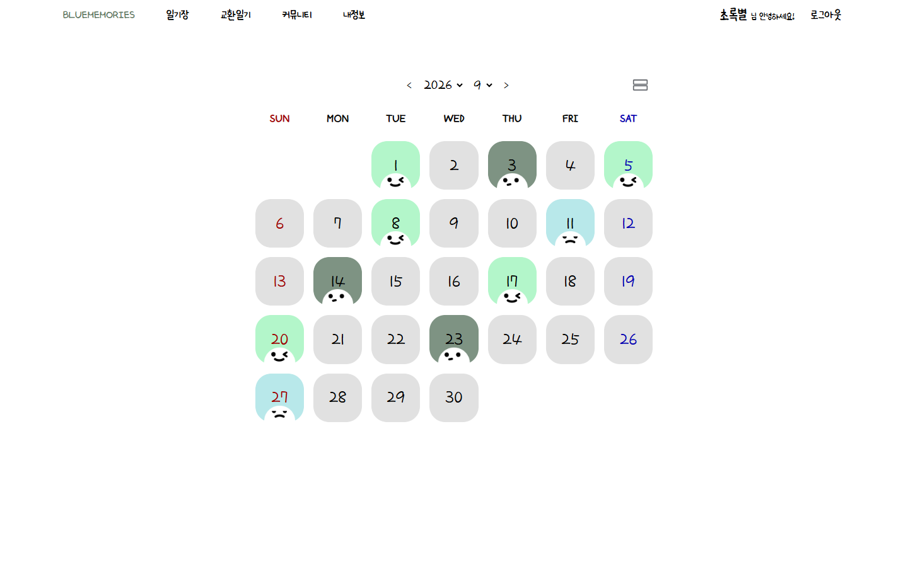
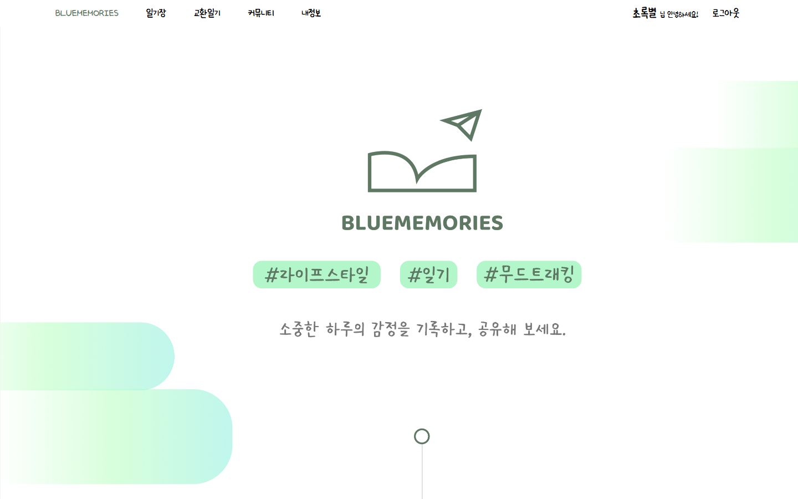
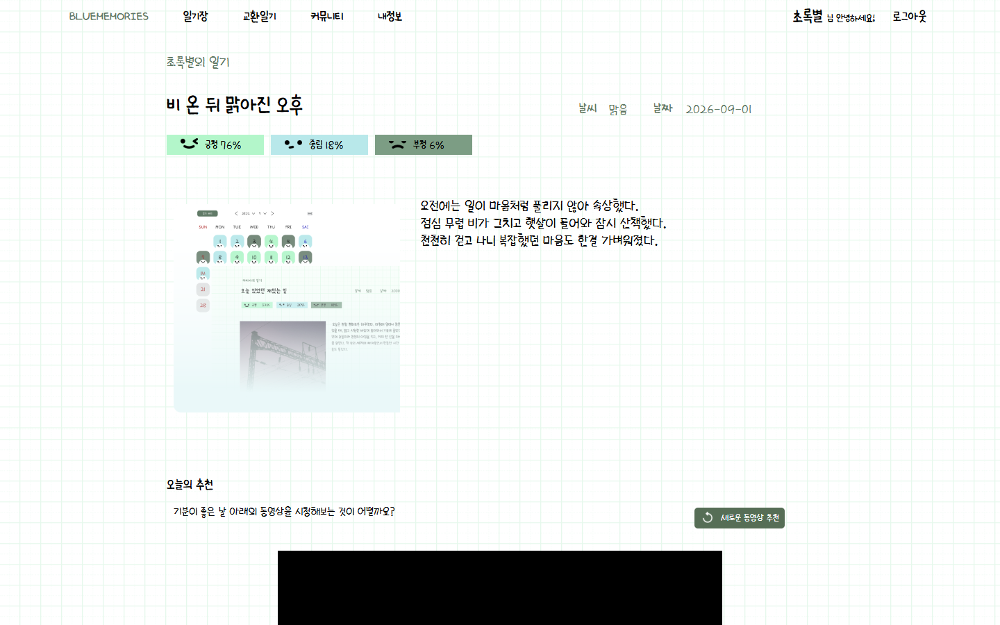
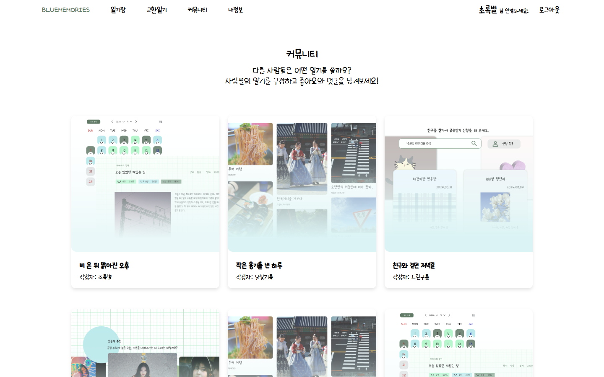
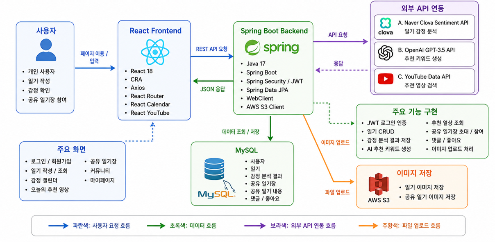

# BlueMemories · AI 감정 기록 및 멘탈케어 커뮤니티

> 일기를 쓰면 AI가 감정을 분석하고 기분에 맞는 영상을 추천하는 감정 일기 서비스입니다.
> 1:1 교환일기를 여러 명이 함께 쓰는 공유 일기장으로 확장하고, 공개 일기를 나누는 커뮤니티를 더했습니다.



| 기간 | 팀 구성 | 내 역할 |
| --- | --- | --- |
| 2024.07 ~ 2024.09 | 2인 팀 (개발 1 · 디자인 1) | 기획 및 백엔드/프론트엔드 개발 총괄 |

**링크** · [포트폴리오 상세](https://portfolio-sys13-9a4d.vercel.app/projects/bluememories)

> 프로젝트 종료 후 AI 응답 계약·기본값 처리, 커뮤니티 목록 조회 등을 **사후 개선**했습니다. 본문에서 해당 내용에 "(사후 개선)"을 붙였습니다.

## 프로젝트 배경

"사용자가 자신의 감정을 더 쉽고 깊이 있게 돌아볼 수 있을까?"라는 질문에서 시작한 BlueMemories 리뉴얼 프로젝트입니다.

- 기존 Ver 1.0의 아쉬운 점을 보완하기 위해 디자이너와 1:1로 협업해 UI/UX를 전면 개편했습니다.
- '일기 작성'과 '콘텐츠 추천'이라는 핵심 경험은 유지하고, 1:1 교환일기를 여러 명이 쓰는 **공유 일기장**으로 확장했습니다. 소통을 위한 **커뮤니티**도 새로 만들었습니다.
- 리뉴얼 후 테스터에게서 *"이전 버전보다 훨씬 직관적이며, 특히 '감정 캘린더' 기능 덕분에 나의 감정 변화를 돌아보는 것이 즐거워졌다"* 는 피드백을 받았습니다.

## 주요 기능

| 기능 | 설명 |
| --- | --- |
| 일기 작성·조회 | 제목, 본문, 날씨, 공개 여부, 이미지를 함께 저장합니다. 날짜별 조회와 제목·내용 검색을 지원합니다. |
| AI 감정 분석 | 프로젝트 당시에는 Naver Clova로 긍정·중립·부정 점수를 받았습니다. 사후 개선으로 OpenAI 또는 Ollama를 선택하고, JSON 점수를 서버에서 검증한 뒤 저장합니다. |
| 감정 캘린더 | 월별 일기의 감정 결과를 달력에 표정 아이콘으로 표시해 한 달의 감정 흐름을 보여 줍니다. |
| 콘텐츠 추천 | 감정 점수를 바탕으로 AI가 노래 2개와 검색어 2개를 만들고, YouTube Data API로 영상 4개를 찾아 일기 상세 화면에 보여 줍니다. |
| 공유 일기장 | 일기장 생성·삭제, 멤버 초대·수락·거절·취소, 공유 일기 작성, 정렬, 제목·내용·닉네임 검색을 제공합니다. |
| 커뮤니티 | 공개 일기를 카드 목록으로 보여 주고, 댓글과 좋아요를 남길 수 있습니다. (페이지 단위 조회는 사후 개선) |
| 인증·이미지 | 아이디·닉네임 중복 확인 후 가입, JWT 기반 인증, BCrypt 비밀번호 저장. 첨부 이미지는 AWS S3에 업로드합니다. |

| 서비스 홈 | 일기 상세 | 커뮤니티 |
| --- | --- | --- |
|  |  |  |
| 하루의 감정을 기록하고 공유하는 핵심 가치를 소개 | 본문, 날씨, 감정 점수와 오늘의 추천 영역 | 공개 일기를 이미지 카드로 탐색하고 상세 화면으로 이동 |

<details>
<summary>리뉴얼 당시 Figma 디자인 시안</summary>

**감정 분석 및 AI 추천** - 일기를 쓰면 긍정·중립·부정 수치가 나타나고, 기분에 맞는 유튜브 영상을 추천합니다.


**교환 일기(공유 일기장)** - 친구를 초대해 함께 쓰는 일기장을 만들고, 멤버 초대·수락을 관리합니다.


**커뮤니티 & 좋아요** - 공개 설정한 일기가 커뮤니티에 공유되고, 좋아요와 댓글로 소통합니다.


</details>

## 내가 맡은 부분

디자이너 1인과 협업했고, 기획과 백엔드·프론트엔드 개발을 맡았습니다.

**프로젝트 기간**

- Spring Boot REST API: 일기, 공유 일기장(초대·수락·거절), 커뮤니티·댓글·좋아요, 회원 가입·로그인
- JWT 인증 필터와 Spring Security 설정, AWS S3 이미지 업로드
- WebClient로 외부 API 연동: 감정 분석(초기 Naver Clova), OpenAI 추천, YouTube 영상 검색
- 1:1 교환일기를 N:M 공유 일기장으로 확장: 사용자와 일기장을 [`SharedDiaryUser`](backend/src/main/java/com/backend/domain/SharedDiaryUser.java) 연결 엔티티로 묶고, 초대 요청(보낸 사람·받는 사람·메시지)은 [`SharedDiaryApplication`](backend/src/main/java/com/backend/domain/SharedDiaryApplication.java)으로 관리
- React 화면: 메인, 일기 작성·상세, 감정 캘린더, 공유 일기장, 커뮤니티, 마이페이지

**사후 개선 (프로젝트 종료 후)**

- 추천 흐름을 `block()` 호출에서 `Mono` 체인으로 변경
- AI 제공자 추상화: [`AiChatClient`](backend/src/main/java/com/backend/service/AiChatClient.java)를 OpenAI·Ollama가 구현하고 `ai.provider` 설정으로 선택
- 감정 분석·추천 응답을 JSON 계약으로 바꾸고 검증, 재시도, 기본값 처리 추가
- 커뮤니티 목록을 DTO Projection과 페이지네이션으로 변경
- S3 이미지를 1시간 유효한 Presigned URL로 조회, 환경 변수 기반 설정과 백엔드 Dockerfile 추가, 반응형 UI 개선

## 문제 해결

### 1. AI 응답 형식이 바뀌면 추천 키워드가 누락되는 문제 (사후 개선)

- **문제**: 프롬프트로 `1. 노래: … / 3. 검색어: …` 같은 번호 형식을 유도하고 정규식으로 키워드를 뽑았습니다. AI가 문구나 순서를 조금만 바꿔도 키워드가 빠졌습니다.
- **해결**: 응답을 `songs[]`, `searchKeywords[]` JSON 계약으로 고정하고 `ObjectMapper`로 [`AiRecommendationResponse`](backend/src/main/java/com/backend/dto/AiRecommendationResponse.java)에 파싱합니다. 두 배열이 각각 정확히 2개이고 빈 문자열이 없는지 서버에서 검증합니다. 실패하면 재시도 프롬프트로 한 번 더 요청하고, 그래도 실패하면 기본 추천값을 사용합니다.
- **감정 분석도 같은 방식**: 점수가 0~100인지, 세 점수 합이 100인지, `sentiment`가 가장 높은 점수와 일치하는지 검증합니다. 두 번 실패하면 중립 기본값을 저장합니다.
- **결과**: 형식 오류를 서버에서 감지하고, AI 응답에 문제가 있어도 일기 저장과 추천 화면이 중단되지 않습니다.

```json
{"songs":["song title artist","song title artist"],"searchKeywords":["keyword","keyword"]}
```

코드: [`RecommendService.java`](backend/src/main/java/com/backend/service/RecommendService.java) · [`SentimentAnalysisService.java`](backend/src/main/java/com/backend/service/SentimentAnalysisService.java) · [`DiaryServiceImpl.java`](backend/src/main/java/com/backend/service/DiaryServiceImpl.java)

### 2. 커뮤니티 목록에서 연관 데이터를 반복 조회하는 문제 (사후 개선)

- **문제**: 공개 일기 Entity를 모두 조회한 뒤 일기마다 작성자 정보를 다시 조회했습니다(페이지 구분 없이 전체 반환).
- **해결**: JPQL `select new` DTO Projection으로 작성자 닉네임과 댓글·좋아요 수를 한 쿼리에서 집계해 [`PublicDiaryListResponse`](backend/src/main/java/com/backend/dto/PublicDiaryListResponse.java)로 바로 반환합니다. `Pageable`로 페이지 단위 조회(기본 20개, 작성일 내림차순)를 하고 count 쿼리는 따로 둡니다.
- **결과**: 로컬 JMeter 테스트에서 평균 응답 시간이 147.85ms에서 3.63ms로 감소했습니다.

코드: [`DiaryRepository.java`](backend/src/main/java/com/backend/repository/DiaryRepository.java) · [`DiaryController.java`](backend/src/main/java/com/backend/controller/DiaryController.java)

## 기술 스택

| 구분 | 기술 |
| --- | --- |
| Backend | Java 17, Spring Boot 3.3.2, Spring MVC, Spring Security, Spring Data JPA, Spring WebFlux(WebClient), jjwt 0.11.5, Lombok, Gradle 8.8 |
| Frontend | React 18, Create React App(react-scripts 5.0.1), React Router 6, styled-components 6, Axios, react-calendar, react-youtube |
| Data / Infra | MySQL, AWS S3(spring-cloud-starter-aws 2.2.6.RELEASE) |
| AI / 외부 API | Naver Clova Sentiment(감정 분석), OpenAI Chat Completions(추천, 초기 `gpt-3.5-turbo`), YouTube Data API v3 |
| Test | JUnit 5 |
| 사후 개선 | Ollama(기본 모델 `qwen2.5:14b`), OpenAI 기본 모델 `gpt-4o-mini`, Spring Boot Actuator(health), Docker(eclipse-temurin:17-jre), H2(test 프로필) |

## 아키텍처



- React가 REST API(`/api`)로 Spring Boot 서버를 호출하고, 서버는 MySQL에 사용자·일기·감정 결과·공유 일기장·댓글/좋아요를, AWS S3에 이미지를 저장합니다.
- 일기를 저장하면 감정 분석 → 추천 검색어 생성 → YouTube 검색 순서로 WebClient를 통해 외부 API를 호출합니다. 추천이 실패해도 빈 추천값으로 일기를 저장합니다(사후 개선).
- 그림은 초기 버전(Naver Clova, GPT-3.5) 기준입니다. 현재 코드는 감정 분석과 추천 모두 `ai.provider`로 OpenAI 또는 Ollama를 선택합니다(사후 개선). 그림의 '일기 CRUD' 중 수정·삭제 API는 없고, 일기는 작성·조회만 제공합니다.

## 실행 방법

필요한 것: JDK 17, Node.js(npm), MySQL, AWS S3 버킷, YouTube Data API 키, AI 제공자(로컬 Ollama 서버 또는 OpenAI API 키).
기본 설정의 `ai.provider`는 `ollama`이며, `http://localhost:11434`의 Ollama 서버와 `qwen2.5:14b` 모델을 사용합니다.

### 백엔드 (로컬)

```bash
cd backend
cp src/main/resources/application-local.example.properties src/main/resources/application-local.properties
# DB, JWT, S3, AI 제공자, YouTube 키 값을 채운 뒤
./gradlew bootRun --args='--spring.profiles.active=local'
```

`local` 프로필은 `server.servlet.context-path=/api`로 8080 포트에서 동작합니다.

### 프론트엔드

```bash
cd frontend
npm install
npm start   # http://localhost:3000
```

개발 서버의 `/api` 요청은 [`setupProxy.js`](frontend/src/setupProxy.js)가 `http://localhost:8080`으로 전달합니다.

### 테스트

```bash
cd backend
./gradlew test   # test 프로필, H2 인메모리 DB로 컨텍스트 로딩 확인
```

### 배포 설정 (사후 개선)

`--spring.profiles.active=example`(또는 `SPRING_PROFILES_ACTIVE=example`)로 실행하면 [`application-example.properties`](backend/src/main/resources/application-example.properties)가 다음 환경 변수를 읽습니다. 헬스 체크는 `/actuator/health`로 노출됩니다.

| 구분 | 환경 변수 |
| --- | --- |
| DB / JPA | `MYSQL_URL`, `MYSQL_USERNAME`, `MYSQL_PASSWORD`, `JPA_DDL_AUTO`, `JPA_SHOW_SQL` |
| 보안 | `JWT_SECRET`, `JWT_EXPIRATION_MILLIS`, `CORS_ALLOWED_ORIGINS` |
| AWS S3 | `AWS_ACCESS_KEY`, `AWS_SECRET_KEY`, `AWS_REGION`, `AWS_S3_BUCKET` |
| AI | `AI_PROVIDER`, `OLLAMA_BASE_URL`, `OLLAMA_MODEL`, `OPENAI_BASE_URL`, `OPENAI_MODEL`, `OPENAI_API_KEY` |
| 외부 API | `YOUTUBE_API_KEY` |

## 폴더 구조

```text
BlueMemories/
├── backend/                     # Spring Boot API (Gradle)
│   ├── Dockerfile
│   └── src/main/java/com/backend/
│       ├── controller/          # 일기, 공유 일기장, 댓글, 좋아요, 회원 API
│       ├── service/             # 비즈니스 로직, AI·YouTube·S3 연동
│       ├── repository/          # Spring Data JPA
│       ├── domain/              # JPA 엔티티
│       ├── dto/
│       ├── config/              # Security, CORS, S3 설정
│       ├── security/            # JWT 인증 필터
│       └── util/                # JWT 발급·검증
├── frontend/                    # React (Create React App)
│   └── src/pages/               # main, diary, sharedDiary, community, join, nav
└── docs/images/                 # README 이미지
```
